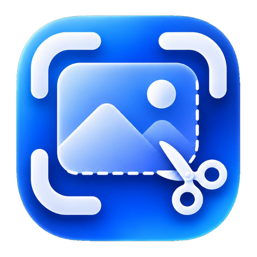
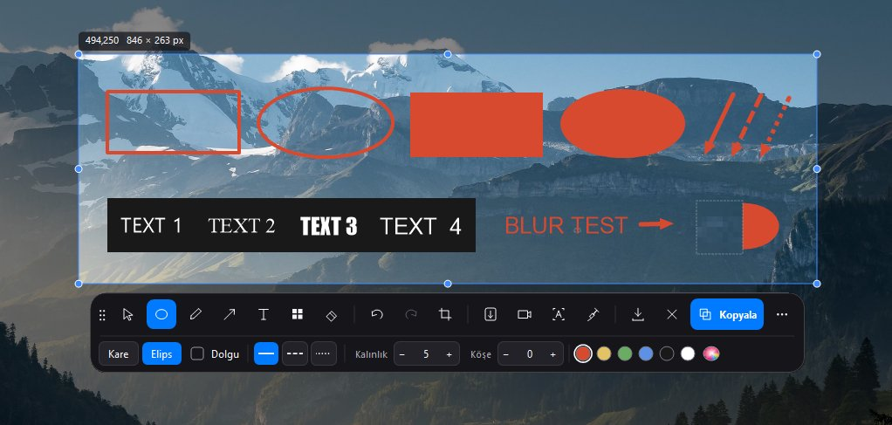

<div align="right">

**English** · [Türkçe](README.tr.md)

</div>

<h1> SnapDesk</h1>

A lightweight Windows utility for screen capture, annotation, floating pins, and OCR.

SnapDesk runs entirely offline with zero telemetry, accounts, or background network requests. Built with .NET 10 and C# for Windows.

[**Download for Windows (x64)**](https://github.com/ardayesilgul/snapdesk/releases/latest/download/SnapDesk.exe) · [All Releases](https://github.com/ardayesilgul/snapdesk/releases)



## Features

- **Screen Capture:** Capture custom regions, active windows, or full displays (`Ctrl+A`). Includes a 9x pixel magnifier with RGB hex readout, dynamic size dimensions, and fine-tuning handles.
- **Annotation Suite:** Rectangles, ellipses, arrows, lines, freehand pen, and highlighters. Supports dashed/dotted strokes, customizable corner radius, fill transparency, and custom palette colors.
- **Text & Numbering:** Inline text editing with configurable fonts, weights, sizes, and contrast outlines. Step-by-step sequential number badges (1, 2, 3...) for walkthroughs.
- **Privacy Obfuscation:** Pixelated mosaic and gaussian blur tools with adjustable block size and strength.
- **Floating Pins:** Pin any capture directly onto your desktop. Pins stay always on top, support smooth mouse-wheel zooming, dragging, click-through mode, and copy/OCR directly from the context menu.
- **Local OCR:** Offline text recognition powered by Windows OCR APIs. Retains original text formatting, line breaks, and allows immediate copy or plain text export.
- **Scrolling Capture:** Vertical capture stitching for long documents and web pages.
- **Screen Recording:** Region-based video recording powered by FFmpeg with pause, resume, and MP4/GIF export.

## Keyboard Shortcuts

### Global Shortcuts

| Shortcut | Action |
| --- | --- |
| `Ctrl + 1` | Region capture & editor |
| `Ctrl + 2` | Capture & direct pin |
| `Ctrl + 3` | Scrolling capture |
| `Ctrl + 4` | Region video recording |

*All shortcuts can be remapped from the Tray Menu → Settings.*

### Editor Shortcuts

| Key | Action |
| --- | --- |
| Drag | Select area (click on window to select window bounds) |
| `R` `O` `P` `A` `L` | Rectangle, Ellipse, Pen, Arrow, Line |
| `T` `N` `M` `B` `H` | Text, Numbering, Mosaic, Blur, Highlighter |
| `Ctrl + Z` / `Ctrl + Y` | Undo / Redo |
| `Ctrl + C` / `Enter` | Copy selection to clipboard and close |
| `Ctrl + S` | Save image (PNG, JPEG) |
| `Ctrl + T` | Pin selection to screen |
| `Shift + C` | Run OCR on selection |
| `Esc` | Cancel / exit editor |
| Arrow keys (+`Shift`) | Nudge selection by 1 px (10 px) |

## Requirements

- Windows 10 (version 2004+) or Windows 11 (x64)
- .NET 10 Runtime (or .NET 10 SDK to build from source)
- *Optional for video recording:* [FFmpeg](https://ffmpeg.org/) in system `PATH` (e.g. `winget install Gyan.FFmpeg`)
- *For OCR:* Standard Windows Language Pack corresponding to your text language (Settings → Time & Language)

## Building from Source

Prerequisites: [.NET 10 SDK](https://dotnet.microsoft.com/download/dotnet/10.0).

```powershell
# Clone repository
git clone https://github.com/ardayesilgul/snapdesk.git
cd snapdesk

# Run unit tests
dotnet test SnapDesk.sln

# Build and run
dotnet run --project src/SnapDesk
```

### Publishing Single-File Executable

```powershell
dotnet publish src/SnapDesk -c Release -r win-x64 --self-contained true -p:PublishSingleFile=true -p:IncludeNativeLibrariesForSelfExtract=true -o dist/SingleFile
```

Or run the automated publish script:

```powershell
powershell -ExecutionPolicy Bypass -File scripts/publish.ps1
```

## Storage & Configuration

- Configuration: `%APPDATA%\SnapDesk\settings.json`
- Default capture save path: `%USERPROFILE%\Pictures\SnapDesk`

## License

This project is licensed under the [MIT License](LICENSE).
