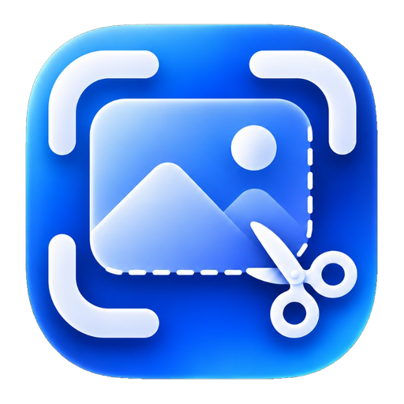
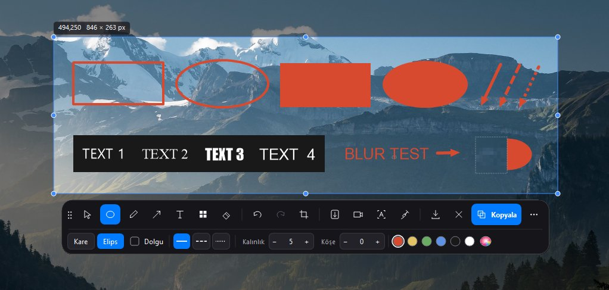

<div align="center">
  
  <h1>SnapDesk</h1>
  <p>
    Windows için ekran görüntüsü alma, çizim ve düzenleme, ekrana sabitleme (pin) ve yerel metin tanıma (OCR) aracı.<br />
    SnapDesk tamamen çevrimdışı çalışır; telemetri, hesap zorunluluğu veya arka planda ağ bağlantısı içermez. .NET 10 ve C# ile Windows masaüstü ortamı için geliştirilmiştir.
  </p>
  <p>
    <a href="https://github.com/ardayesilgul/snapdesk/releases/latest/download/SnapDesk.exe">
      
    </a>
  </p>
  <p>
    <sub>Tek dosya taşınabilir <code>.exe</code> · Windows 10/11 (x64) · <a href="https://github.com/ardayesilgul/snapdesk/releases">Tüm Sürümler</a> · <a href="README.md">English</a> · <strong>Türkçe</strong></sub>
  </p>
</div>



## Özellikler

- **Ekran Yakalama:** Özel bölge, etkin pencere algılama veya tüm ekran (`Ctrl+A`). RGB hex renk ve koordinat göstergeli 9x piksel büyüteci, anlık piksel boyut etiketi ve hassas ayar tutamaçları.
- **Çizim ve Düzenleme:** Dikdörtgen, elips, ok, düz çizgi, serbest çizim kalemi ve fosforlu vurgulayıcı. Kesikli/noktalı çizgi desteği, ayarlanabilir köşe yarıçapı, opaklık ve özel renk paleti.
- **Metin ve Numaralandırma:** Yazı tipi, kalınlık, boyut ve kontrast dış kontur ayarlı doğrudan metin yerleştirme. Rehberler ve adımlar için sıralı tıklanabilir numara rozetleri (1, 2, 3...).
- **Gizleme (Mozaik ve Bulanıklık):** Ayarlanabilir blok boyutu ve yoğunluğuyla pikselli mozaik veya yumuşak Gauss bulanıklığı.
- **Ekrana Sabitleme (Pin):** Yakalanan görseli masaüstünde her zaman en üstte kalacak şekilde sabitleme. Fare tekerleğiyle yakınlaştırma/uzaklaştırma (zoom), sürükleme, tıklama geçirgenliği (click-through) ve sağ tık menüsünden doğrudan panoya kopyalama veya OCR çalıştırma.
- **Yerel Metin Tanıma (OCR):** Windows yerel OCR altyapısıyla tamamen çevrimdışı metin tanıma. Satır düzenini ve boşlukları korur, doğrudan panoya kopyalanabilir veya `.txt` olarak kaydedilebilir.
- **Uzun (Kaydırmalı) Yakalama:** Tekerlek kaydırmalı örtüşme eşleme ile uzun sayfaları ve belgeleri dikeyde birleştirme.
- **Bölge Video Kaydı:** FFmpeg altyapısıyla duraklat/devam et destekli bölge kaydı, MP4 ve GIF olarak dışa aktarma.

## Kısayollar

### Genel Kısayollar

| Kısayol | İşlev |
| --- | --- |
| `Ctrl + 1` | Bölge yakalama ve düzenleyiciyi aç |
| `Ctrl + 2` | Yakalama ve doğrudan ekrana sabitleme |
| `Ctrl + 3` | Uzun (kaydırmalı) yakalama |
| `Ctrl + 4` | Bölge video kaydı |

*Tüm kısayollar Tepsi Menüsü → Ayarlar üzerinden özelleştirilebilir.*

### Düzenleyici Kısayolları

| Tuş | İşlev |
| --- | --- |
| Sürükle | Bölge seçimi (seçim yokken pencereye tıklandığında pencereyi seçer) |
| `R` `O` `P` `A` `L` | Dikdörtgen, Elips, Kalem, Ok, Çizgi |
| `T` `N` `M` `B` `H` | Metin, Numaralandırma, Mozaik, Bulanık, Vurgu |
| `Ctrl + Z` / `Ctrl + Y` | Geri Al / İleri Al |
| `Ctrl + C` / `Enter` | Panoya kopyala ve kapat |
| `Ctrl + S` | Resmi kaydet (PNG, JPEG) |
| `Ctrl + T` | Ekrana sabitle (pin) |
| `Shift + C` | Seçilen alanda metni tanı (OCR) |
| `Esc` | İptal / düzenleyiciden çıkış |
| Ok tuşları (+`Shift`) | Seçimi 1 px (10 px) kaydır |

## Sistem Gereksinimleri

- Windows 10 (sürüm 2004+) veya Windows 11 (x64)
- .NET 10 Çalışma Zamanı (kaynaktan derlemek için .NET 10 SDK)
- *Video kaydı için (isteğe bağlı):* Sistem `PATH` yolunda [FFmpeg](https://ffmpeg.org/) (örn. `winget install Gyan.FFmpeg`)
- *OCR için:* Metin diliyle eşleşen Windows Dil Paketi (Ayarlar → Zaman ve Dil)

## Kaynaktan Derleme

Gereksinim: [.NET 10 SDK](https://dotnet.microsoft.com/download/dotnet/10.0).

```powershell
# Depoyu klonlayın
git clone https://github.com/ardayesilgul/snapdesk.git
cd snapdesk

# Birim testlerini çalıştırın
dotnet test SnapDesk.sln

# Derleyin ve çalıştırın
dotnet run --project src/SnapDesk
```

### Tek Dosya (Single-File) Olarak Paketleme

```powershell
dotnet publish src/SnapDesk -c Release -r win-x64 --self-contained true -p:PublishSingleFile=true -p:IncludeNativeLibrariesForSelfExtract=true -o dist/SingleFile
```

Veya otomatik yayınlama betiğini çalıştırın:

```powershell
powershell -ExecutionPolicy Bypass -File scripts/publish.ps1
```

## Yapılandırma ve Konumlar

- Yapılandırma dosyası: `%APPDATA%\SnapDesk\settings.json`
- Varsayılan ekran görüntüsü klasörü: `%USERPROFILE%\Pictures\SnapDesk`

## Lisans

Bu proje [MIT Lisansı](LICENSE) kapsamında açık kaynak olarak dağıtılmaktadır.
